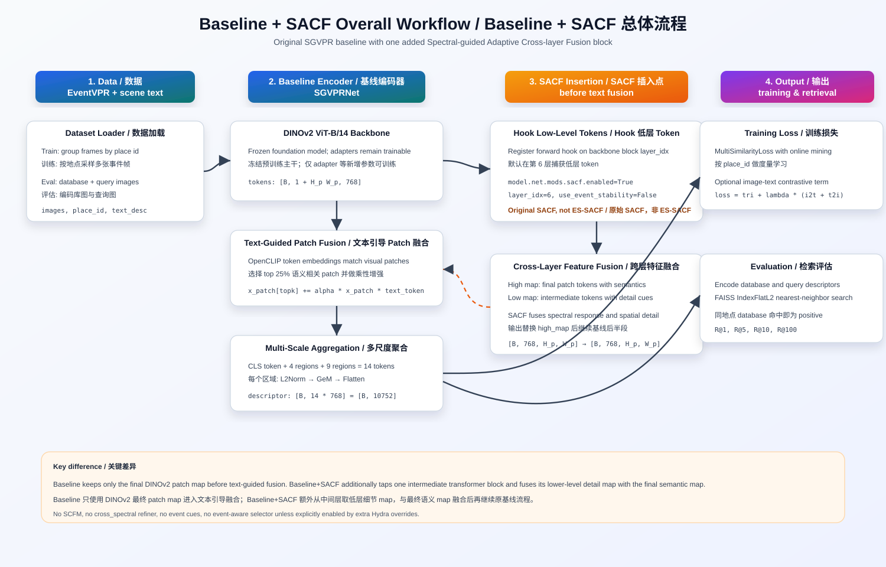
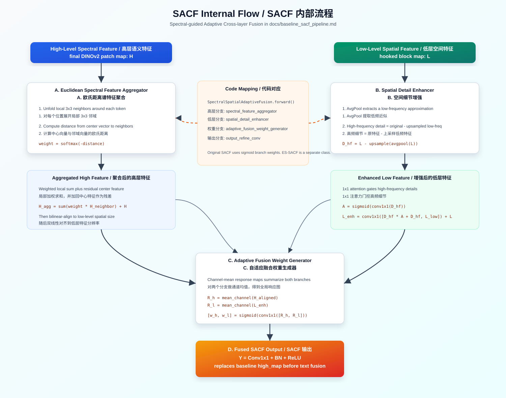

# Baseline + SACF Detailed Workflow / Baseline + SACF 详细流程解说

This document explains the **EPRBench Lightning baseline plus original SACF**
pipeline as implemented in this repository. It is written to be usable as a
standalone method explanation for reports, slides, or experiment notes.

本文档说明本仓库中 **EPRBench Lightning baseline + 原始 SACF** 的完整流程，可直接用于
汇报、实验记录或方法介绍。



## 1. Scope / 说明范围

**中文。** 这里的 **baseline** 指默认 `configs/model/eprbench.yaml` 下的
SGVPR 模型：使用 DINOv2 ViT-B/14 视觉主干、OpenCLIP 文本编码、文本引导的 patch
选择与融合、多尺度 GeM 聚合、2 层 TransformerEncoder、以及最终 L2 归一化地点描述子。
默认情况下，`sacf`、`scfm`、`cross_spectral`、`event_cues`、`event_aware_token_selector`
等新增模块都是关闭的。

**English.** In this document, **baseline** means the SGVPR model configured by
default in `configs/model/eprbench.yaml`: a DINOv2 ViT-B/14 visual backbone, an
OpenCLIP text encoder, text-guided patch selection and fusion, multi-scale GeM
aggregation, a 2-layer TransformerEncoder, and a final L2-normalized place
descriptor. By default, newly added modules such as `sacf`, `scfm`,
`cross_spectral`, `event_cues`, and `event_aware_token_selector` are disabled.

**中文。** **Baseline + SACF** 指在 baseline 上只启用原始
`SpectralSpatialAdaptiveFusion` 模块：

```bash
python src/train.py \
  model.net.mods.sacf.enabled=True \
  model.net.mods.sacf.use_event_stability=False
```

**English.** **Baseline + SACF** means enabling only the original
`SpectralSpatialAdaptiveFusion` module on top of the baseline:

```bash
python src/train.py \
  model.net.mods.sacf.enabled=True \
  model.net.mods.sacf.use_event_stability=False
```

This is **not** ES-SACF. It does not use event cues, semantic score maps, or the
softmax residual gate from `EventStabilitySACF` unless extra Hydra overrides are
explicitly added.

这不是 ES-SACF。除非额外添加 Hydra override，否则它不会使用事件 cue、语义分数图，
也不会使用 `EventStabilitySACF` 中的 softmax 残差门控。

## 2. Configuration Entry Points / 配置与入口

**Training baseline / 训练 baseline:**

```bash
python src/train.py logger=mlflow logger.mlflow.run_name=baseline
```

**Training baseline + SACF / 训练 baseline + SACF:**

```bash
python src/train.py \
  model.net.mods.sacf.enabled=True \
  model.net.mods.sacf.use_event_stability=False \
  logger=mlflow \
  logger.mlflow.run_name=baseline_sacf
```

**Evaluation / 评估:**

```bash
python src/eval.py \
  ckpt_path=/path/to/baseline_sacf.ckpt \
  model.net.mods.sacf.enabled=True \
  model.net.mods.sacf.use_event_stability=False
```

**中文。** 评估时的模型结构必须与 checkpoint 匹配。如果用未训练 SACF 的 baseline
checkpoint 直接打开 `sacf.enabled=True`，SACF 参数没有经过训练，结果不能代表
baseline+SACF。

**English.** The evaluation architecture must match the checkpoint. If a
baseline-only checkpoint is evaluated with `sacf.enabled=True`, the SACF
parameters are not trained and the result should not be interpreted as a true
baseline+SACF result.

Key default settings:

| Item | Value |
|---|---:|
| Visual backbone / 视觉主干 | DINOv2 ViT-B/14 |
| Visual dimension / 视觉维度 | 768 |
| Text encoder / 文本编码器 | OpenCLIP `ViT-B-16`, `laion2b_s34b_b88k` |
| Pretrained foundation / 预训练基础模型 | `pretrained_foundation=true` |
| Frequency enhancement / 频域增强 | `use_frequency_enhance=false` |
| Patch keep ratio / patch 保留比例 | 0.25 |
| Output descriptor / 输出描述子 | `14 * 768 = 10752` |
| Optimizer / 优化器 | AdamW, `lr=1e-4`, `weight_decay=1e-3` |
| Main loss / 主损失 | MultiSimilarityLoss + online miner |
| Image-text contrast / 图文对比损失 | `lambda_contrast=0.15`, `temperature=0.07` |
| SACF default layer / SACF 默认层 | `layer_idx=6` |

## 3. Data Flow / 数据流程

**中文。** 数据集入口是 `EPRBenchDataModule` 和 `EventVPRDataset`。训练阶段读取
`train/database` 与 `train/queries`，根据文件夹名中的地点字段生成 place id，并从每个地点
随机采样 `img_per_place` 张图。每个训练样本包含同一地点的多张事件帧、对应 place id，
以及同一场景的文本描述。

**English.** Data is loaded through `EPRBenchDataModule` and `EventVPRDataset`.
During training, both `train/database` and `train/queries` are scanned. Folder
names are converted into place ids, and `img_per_place` frames are sampled from
each place. Each training sample contains multiple event frames from one place,
their place ids, and the corresponding scene description.

**中文。** 本文用 `H_p x W_p` 表示 patch 网格大小，因为它由实际输入图像尺寸和 patch size
动态决定。当前 dataset 默认 transform 会把图像 resize 到 `224x224`；DINOv2 会对位置编码做
插值，因此网络流程仍按实际 patch 数恢复空间网格。

**English.** This document uses `H_p x W_p` for the patch grid size because it
is determined dynamically by the actual input image size and patch size. The
current dataset default transform resizes images to `224x224`; DINOv2
interpolates positional embeddings, so the network reconstructs the spatial
grid from the actual number of patch tokens.

Training batch shape:

| Stage / 阶段 | Tensor or object / 张量或对象 | Shape / 形状 |
|---|---|---|
| Dataset output / 数据集输出 | images | `[BS, N, 3, H, W]` |
| Dataset output / 数据集输出 | place_id | `[BS, N]` |
| Dataset output / 数据集输出 | text | list of `BS * N` strings after flattening |
| Lightning training step / Lightning 训练步 | images | `[BS * N, 3, H, W]` |
| Lightning training step / Lightning 训练步 | labels | `[BS * N]` |

**中文。** 验证和测试阶段读取 `test/database` 与 `test/queries`。所有 database 图像排在
前面，所有 query 图像排在后面。模型先为每张图生成 descriptor，再按索引恢复顺序，最后用
FAISS 在 database descriptor 中检索 query 的最近邻。

**English.** During validation and testing, `test/database` and `test/queries`
are loaded. Database images are placed first, query images second. The model
encodes every image into a descriptor, restores the dataset order by index, and
uses FAISS to retrieve nearest database descriptors for each query.

## 4. Baseline Forward Path / Baseline 前向流程

**Step 1: DINOv2 visual encoding / 第 1 步：DINOv2 视觉编码。**

**中文。** 输入事件帧会被送入 DINOv2 ViT-B/14。主干输出包含 CLS token 和 patch token。
LightningModule 初始化时会冻结 backbone 中除 `adapter` 以外的参数；adapter 以及后续新增
模块参与训练。

**English.** Event frames are fed into DINOv2 ViT-B/14. The backbone returns a
CLS token and patch tokens. During LightningModule initialization, backbone
parameters are frozen except those whose names contain `adapter`; adapters and
downstream modules remain trainable.

```text
visual tokens = [CLS, patch_1, patch_2, ..., patch_N]
patch tokens  = [B, H_p * W_p, 768]
patch map     = [B, 768, H_p, W_p]
```

**Step 2: Text encoding / 第 2 步：文本编码。**

**中文。** 场景描述由 OpenCLIP 编码成两类特征：句级向量用于图文对比损失，token 级向量用于
patch 与文本 token 的相似度匹配。token 级特征维度会投影到 768，与 DINOv2 patch token 对齐。

**English.** Scene descriptions are encoded by OpenCLIP into two forms:
sentence-level embeddings for image-text contrastive loss, and token-level
embeddings for patch-to-word similarity matching. Token embeddings are projected
to 768 dimensions to align with DINOv2 patch tokens.

**Step 3: Text-guided patch fusion / 第 3 步：文本引导 patch 融合。**

**中文。** baseline 会归一化视觉 patch token 与文本 token，计算 patch-word 相似度矩阵。
每个 patch 找到最相似的文本 token，并以相似度作为 patch 分数。默认保留 top 25% patch，
然后把被选中的视觉 patch 与对应文本 token 做逐元素乘法增强，再加回原 patch token。

**English.** The baseline normalizes visual patch tokens and text token
embeddings, then computes a patch-word similarity matrix. Each visual patch
selects its best-matching text token, and the maximum similarity becomes the
patch score. The top 25% patches are retained. Each selected visual patch is
enhanced by elementwise multiplication with its matched text token and added
back to the original patch token.

```text
sim_matrix = normalize(x_patch) @ normalize(text_tokens)^T
score_i    = max_word(sim_matrix[i, word])
k          = max(int(0.25 * num_patches), 1)
x_i        = x_i + alpha_patch * x_i * text_token_best_i    for selected top-k patches
```

**Step 4: Multi-scale regional aggregation / 第 4 步：多尺度区域聚合。**

**中文。** 融合后的 patch map 会被切成多个固定区域做聚合：一个 CLS token、4 个粗粒度区域、
9 个细粒度区域，总共 14 个 768 维 token。每个空间区域内部依次经过 L2Norm、GeM 和
Flatten，得到区域描述子。14 个 token 再经过 2 层 TransformerEncoder，最后展平并做 L2
归一化，得到 10752 维全局地点描述子。

**English.** The fused patch map is aggregated into fixed regions: one CLS
token, four coarse regions, and nine finer regions, giving 14 tokens of 768
dimensions. Each spatial region passes through L2Norm, GeM, and Flatten to
produce a regional descriptor. The 14 tokens are processed by a 2-layer
TransformerEncoder, flattened, and L2-normalized into a 10752-dimensional global
place descriptor.

```text
descriptor = L2Norm(flatten(TransformerEncoder([CLS, 4-region tokens, 9-region tokens])))
descriptor shape = [B, 14 * 768] = [B, 10752]
```

## 5. Where SACF Enters / SACF 插入位置

**中文。** 启用 SACF 后，baseline 的主体不变。唯一新增的是：网络会在 DINOv2 backbone
的某个中间 block 上注册 forward hook，默认是 `blocks[6]`。hook 捕获中间层 token 作为
低层特征；DINOv2 继续前向到最终输出，最终 patch token 作为高层特征。随后 SACF 在文本引导
patch 融合之前，把高层语义特征与低层空间细节特征融合。

**English.** When SACF is enabled, the main baseline pipeline stays unchanged.
The additional operation is a forward hook registered on an intermediate DINOv2
backbone block, by default `blocks[6]`. The hook captures intermediate tokens as
low-level features. The backbone continues to the final output, whose patch
tokens are treated as high-level features. SACF then fuses high-level semantic
features with low-level spatial-detail features before text-guided patch fusion.

```text
low_level_tokens  = output of backbone.blocks[layer_idx]      # default layer_idx = 6
high_level_tokens = final DINOv2 patch tokens

high_map = reshape(high_level_tokens) -> [B, 768, H_p, W_p]
low_map  = reshape(low_level_tokens)  -> [B, 768, H_p, W_p]

high_map = SACF(high_map, low_map)
x_patch  = flatten(high_map)
continue baseline text fusion and aggregation
```

**中文。** 因此 baseline+SACF 与 baseline 的后半段完全一致：SACF 输出会重新变回 patch
token，然后继续进入文本引导 patch 融合、多尺度聚合、descriptor 归一化、训练损失或检索评估。

**English.** Therefore, the second half of baseline+SACF is identical to the
baseline: SACF output is converted back to patch tokens, then sent through
text-guided patch fusion, multi-scale aggregation, descriptor normalization,
training loss, or retrieval evaluation.

## 6. SACF Internal Mechanism / SACF 内部机制



SACF receives two feature maps:

SACF 接收两个特征图：

```text
H = high_level_spectral_feature  # final patch map, stronger semantics
L = low_level_spatial_feature    # hooked intermediate map, richer local detail
H, L shape = [B, 768, H_p, W_p]
```

### 6.1 Spectral Branch / 谱特征分支

**中文。** 高层特征 `H` 会进入 `EuclideanSpectralFeatureAggregator`。该模块对每个空间位置
展开局部邻域，默认窗口为 `3x3`。它计算中心 token 与邻域 token 的欧氏距离，对负距离做
softmax 得到相似度权重，然后对邻域向量加权求和，并把中心特征作为残差加回。

**English.** The high-level feature `H` is processed by
`EuclideanSpectralFeatureAggregator`. For every spatial location, the module
unfolds a local neighborhood, using a `3x3` window by default. It computes the
Euclidean distance between the center token and neighboring tokens, applies
softmax over negative distances to obtain similarity weights, performs a
weighted local sum, and adds the center feature back as a residual.

```text
distance_j = ||H_center - H_neighbor_j||_2
weight_j   = softmax(-distance_j)
H_agg      = sum_j(weight_j * H_neighbor_j) + H_center
```

**中文。** 直观上，这一步让高层语义 token 从局部相似 token 中吸收上下文，使语义响应更加平滑、
稳定，同时保留原始中心位置的信息。

**English.** Intuitively, this step lets high-level semantic tokens absorb
context from locally similar tokens, producing a smoother and more stable
semantic response while preserving the original center information.

### 6.2 Spatial Detail Branch / 空间细节分支

**中文。** 低层特征 `L` 会进入 `SpatialDetailEnhancer`。它先用平均池化得到低频近似，再上采样
回原分辨率；用原始特征减去该低频近似，得到高频细节。随后用 1x1 卷积和 sigmoid 生成高频注意力，
增强重要边缘、纹理和结构响应。最后把增强后的高频细节与经过卷积细化的低频特征拼接，经 1x1
卷积融合，并把原始 `L` 作为残差加回。

**English.** The low-level feature `L` is processed by `SpatialDetailEnhancer`.
It first uses average pooling to obtain a low-frequency approximation and
upsamples it back to the original resolution. The high-frequency detail is
computed by subtracting this low-frequency approximation from the original
feature. A 1x1 convolution followed by sigmoid produces a high-frequency
attention map, enhancing important edge, texture, and structural responses. The
enhanced high-frequency detail is concatenated with a refined low-frequency
feature, fused by a 1x1 convolution, and added back to the original `L` as a
residual.

```text
L_low    = upsample(avgpool(L))
D_high   = L - L_low
A_high   = sigmoid(conv1x1(D_high))
L_enh    = conv1x1([D_high * A_high + D_high, refine(L_low)]) + L
```

### 6.3 Adaptive Fusion / 自适应融合

**中文。** SACF 接下来分别对高层聚合特征和低层增强特征做通道均值，得到两个响应图。两个响应图
拼接后经过 `1x1 Conv(2 -> 2)` 和 sigmoid，得到两个空间自适应权重：高层分支权重和低层分支
权重。注意原始 SACF 使用 sigmoid，因此两个分支权重不是强制和为 1；这与 ES-SACF 中的 softmax
门控不同。

**English.** SACF then computes channel-mean response maps for the aggregated
high-level branch and the enhanced low-level branch. These two response maps are
concatenated and passed through `1x1 Conv(2 -> 2)` and sigmoid to generate two
spatially adaptive weights: one for the high-level branch and one for the
low-level branch. Note that original SACF uses sigmoid, so the two branch
weights are not forced to sum to 1; this differs from the softmax gate in
ES-SACF.

```text
R_high = mean_channel(H_agg)
R_low  = mean_channel(L_enh)
[w_high, w_low] = sigmoid(conv1x1([R_high, R_low]))

F = w_high * H_agg + w_low * L_enh
Y = ReLU(BN(conv1x1(F)))
```

**中文。** 原始 SACF 的输出 `Y` 会直接替换 baseline 中的 `high_map`。它不是 ES-SACF 那种
`high + res_scale * out_proj(fused)` 的零初始化残差形式。

**English.** The original SACF output `Y` directly replaces the baseline
`high_map`. It is not the zero-initialized residual form
`high + res_scale * out_proj(fused)` used by ES-SACF.

## 7. Training Objective / 训练目标

**中文。** 训练时，Lightning step 会把每个地点采样出的多张图展平成一个 batch，并以 place id
作为标签。模型输出 10752 维 descriptor 后，先使用 `pytorch-metric-learning` 的
`MultiSimilarityMiner` 挖掘有效样本对，再使用 `MultiSimilarityLoss` 进行度量学习。

**English.** During training, the Lightning step flattens multiple sampled
images per place into one batch and uses place ids as labels. After the model
produces 10752-dimensional descriptors, `MultiSimilarityMiner` from
`pytorch-metric-learning` mines informative pairs, and `MultiSimilarityLoss`
performs metric learning.

**中文。** 如果启用文本，模型还会用图像 CLS token 的地点级平均值和文本句向量的地点级平均值做
双向图文对比学习。总损失为：

**English.** If text is enabled, the model also computes bidirectional
image-text contrastive learning using the place-level average of image CLS
tokens and the place-level average of sentence embeddings. The total loss is:

```text
loss = MultiSimilarityLoss
     + lambda_contrast * (image_to_text_cross_entropy + text_to_image_cross_entropy)
```

Default values:

默认值：

```text
lambda_contrast = 0.15
temperature     = 0.07
```

## 8. Evaluation / 检索评估

**中文。** 验证和测试时，模型不会计算训练损失，而是为所有 database 和 query 图像提取 descriptor。
所有 descriptor 按数据集索引排序后，前 `database_num` 个作为检索库，后 `queries_num` 个作为查询。
使用 `faiss.IndexFlatL2` 在 10752 维 descriptor 上做最近邻检索。

**English.** During validation and testing, the model does not compute training
loss. It extracts descriptors for all database and query images. Descriptors are
sorted by dataset index; the first `database_num` descriptors form the database,
and the remaining `queries_num` descriptors form the query set. Retrieval is
performed with `faiss.IndexFlatL2` over 10752-dimensional descriptors.

**中文。** 对每个 query，只要其前 K 个预测中存在同 place id 的 database 图像，就记为 Recall@K
命中。默认报告 `R@1`、`R@5`、`R@10`、`R@100`。

**English.** For each query, Recall@K is counted as a hit if any of the top-K
retrieved database images has the same place id. The default reported metrics
are `R@1`, `R@5`, `R@10`, and `R@100`.

```text
database_features -> FAISS IndexFlatL2
query_features    -> nearest-neighbor search
positive match    -> same place id
metrics           -> R@1, R@5, R@10, R@100
```

## 9. Baseline vs. Baseline + SACF / 二者差异

| Part / 部分 | Baseline | Baseline + SACF |
|---|---|---|
| Data pipeline / 数据流程 | Same / 相同 | Same / 相同 |
| DINOv2 final tokens / DINOv2 最终 token | Used / 使用 | Used / 使用 |
| Intermediate DINOv2 tokens / DINOv2 中间层 token | Not used / 不使用 | Hooked from `blocks[layer_idx]` / 从中间层 hook |
| Text-guided patch fusion / 文本引导 patch 融合 | Same / 相同 | Same, after SACF / 相同，但在 SACF 后执行 |
| Multi-scale GeM aggregation / 多尺度 GeM 聚合 | Same / 相同 | Same / 相同 |
| Loss and FAISS evaluation / 损失与 FAISS 评估 | Same / 相同 | Same / 相同 |
| Added parameters / 新增参数 | None from SACF / 无 SACF 参数 | SACF spectral, spatial, fusion, refine layers / SACF 分支参数 |
| Main effect / 主要作用 | Final semantic patch map only / 只使用最终语义 patch map | Fuses final semantics with intermediate spatial detail / 融合最终语义与中间层细节 |

**中文。** 可以把 baseline+SACF 理解为“在 SGVPR 的视觉 patch 表征进入文本融合之前，先做一次跨层细节增强”。它不改变训练监督、不改变检索协议，也不改变最终 descriptor 的维度。

**English.** Baseline+SACF can be understood as “a cross-layer detail-enhancement
step before SGVPR visual patch representations enter text fusion.” It does not
change the supervision, retrieval protocol, or final descriptor dimensionality.

## 10. Practical Notes / 实践注意事项

**中文。**

- `model.net.mods.sacf.enabled=True` 是开启原始 SACF 的关键开关。
- `model.net.mods.sacf.use_event_stability=False` 用于明确保持原始 SACF，而不是 ES-SACF。
- `layer_idx=6` 表示从 DINOv2 第 6 个 transformer block 捕获低层 token，可通过 override 改成其它合法 block。
- SACF 位于文本引导 patch 融合之前，因此它会影响后续 patch-word 相似度、top-k patch 选择和最终 descriptor。
- 如果同时开启其它模块，例如 SCFM、EATS 或 ES-SACF，流程就不再是本文定义的 baseline+SACF。

**English.**

- `model.net.mods.sacf.enabled=True` is the key switch for original SACF.
- `model.net.mods.sacf.use_event_stability=False` explicitly keeps original
  SACF instead of ES-SACF.
- `layer_idx=6` captures low-level tokens from the sixth DINOv2 transformer
  block by default; it can be overridden with another valid block index.
- SACF runs before text-guided patch fusion, so it affects patch-word
  similarity, top-k patch selection, and the final descriptor.
- If other modules such as SCFM, EATS, or ES-SACF are enabled, the pipeline is
  no longer the baseline+SACF pipeline defined here.

## 11. Code Mapping / 代码对应

| Functionality / 功能 | File / 文件 | Symbol / 符号 |
|---|---|---|
| Lightning train/eval logic / Lightning 训练评估逻辑 | `src/models/eprbench_module.py` | `EPRBenchLitModule` |
| SGVPR network / SGVPR 网络 | `src/models/components/network.py` | `SGVPRNet` |
| SACF module / SACF 模块 | `src/models/components/mods/sacf.py` | `SpectralSpatialAdaptiveFusion` |
| SACF spectral branch / SACF 谱分支 | `src/models/components/mods/sacf.py` | `EuclideanSpectralFeatureAggregator` |
| SACF spatial branch / SACF 空间分支 | `src/models/components/mods/sacf.py` | `SpatialDetailEnhancer` |
| Text encoder / 文本编码器 | `src/models/components/backbone/text_encoder_clip.py` | `CLIPTextEncoder` |
| Dataset / 数据集 | `src/data/components/eventvpr_dataset.py` | `EventVPRDataset` |
| DataModule / 数据模块 | `src/data/eprbench_datamodule.py` | `EPRBenchDataModule` |
| Loss / 损失 | `src/models/components/loss.py` | `loss_function` |

## 12. Short Presentation Script / 简短讲解稿

**中文讲解稿。** Baseline 是 SGVPR：它先用 DINOv2 从事件帧中提取视觉 patch token，再用
OpenCLIP 编码场景文本。视觉 patch 与文本 token 做相似度匹配，只增强语义最相关的 top 25%
patch。增强后的 patch map 会被切成 4 个粗区域和 9 个细区域，加上 CLS token，一共形成 14 个
区域 token；这些 token 经过 TransformerEncoder 后展平为 10752 维地点描述子。训练时用
MultiSimilarityLoss 做地点级度量学习，并叠加图文对比损失；测试时用 FAISS 做 database-query
检索并计算 Recall@K。

Baseline+SACF 在 baseline 的视觉表征进入文本融合之前，额外从 DINOv2 中间层 hook 出低层
token。最终层 patch map 负责语义，低层 patch map 提供边缘、纹理和局部结构。SACF 的高层分支
用局部欧氏相似度聚合语义响应，低层分支用低频/高频分解增强空间细节，然后根据两个分支的响应图
生成自适应权重并融合。融合后的 feature map 替换原 baseline 的最终 patch map，后续文本融合、
多尺度聚合、训练损失和检索评估全部保持不变。

**English script.** The baseline is SGVPR. It first uses DINOv2 to extract
visual patch tokens from event frames, and uses OpenCLIP to encode scene text.
Visual patches are matched with text tokens by similarity, and only the top 25%
semantically relevant patches are enhanced. The enhanced patch map is aggregated
into four coarse regions and nine finer regions, plus the CLS token, producing
14 regional tokens. These tokens pass through a TransformerEncoder and are
flattened into a 10752-dimensional place descriptor. During training, the model
uses MultiSimilarityLoss for place-level metric learning and adds an image-text
contrastive loss. During testing, FAISS performs database-query retrieval and
Recall@K is reported.

Baseline+SACF adds one operation before the baseline visual representation
enters text fusion: it hooks low-level tokens from an intermediate DINOv2 block.
The final patch map provides semantic information, while the intermediate patch
map provides edge, texture, and local-structure details. In SACF, the high-level
branch aggregates semantic responses through local Euclidean similarity, and
the low-level branch enhances spatial details through low/high-frequency
decomposition. Adaptive weights are generated from the response maps of both
branches and used to fuse them. The fused feature map replaces the original
baseline final patch map, while text fusion, multi-scale aggregation, training
losses, and retrieval evaluation remain unchanged.

## 13. Checklist / 检查清单

- Baseline command keeps all new modules off unless explicitly overridden.
- Baseline+SACF command enables `sacf.enabled=True` and keeps
  `use_event_stability=False`.
- SACF hook is applied before text-guided patch fusion.
- SACF output shape remains `[B, 768, H_p, W_p]`.
- Final descriptor shape remains `[B, 10752]`.
- Training loss and FAISS evaluation protocol are unchanged from baseline.
